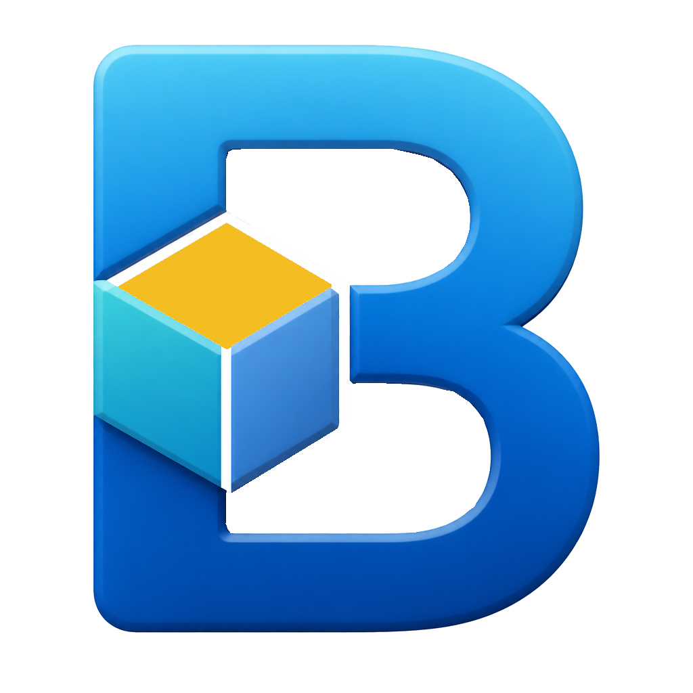
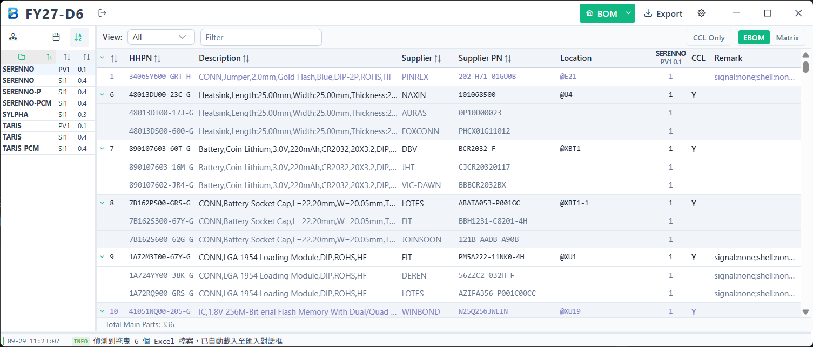
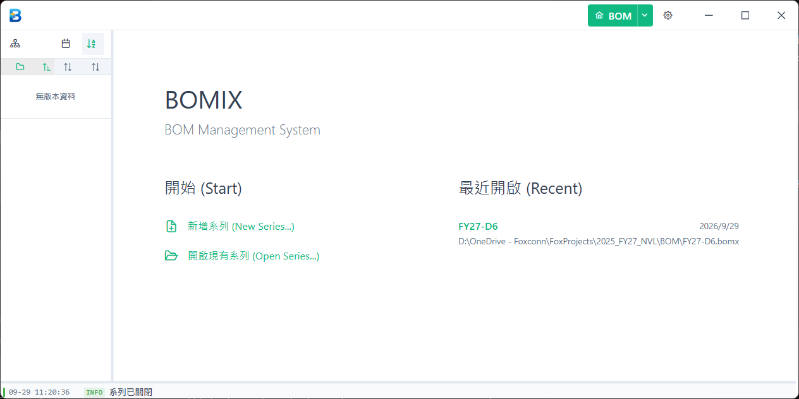
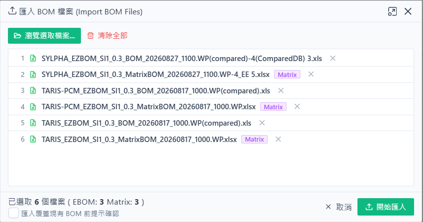
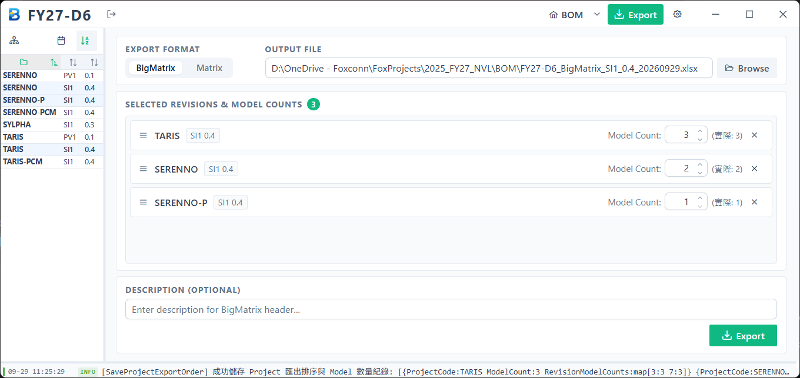

  

    

      
      Official User Guide
    

    <h1 class="cover-title">BOMIX</h1>
    
專業級電子製造 BOM 整合與 Matrix 矩陣管理系統 標準操作流程與功能指南

    

  

  

    

      
<strong>適用版本：</strong>Wave 1 企業正式版

      
<strong>文件編號：</strong>MAN-BOMIX-V1.0-TC

      
<strong>發行日期：</strong>2026 年 09 月

    

    

      
BOMIX Suite

      
High Performance BOM Solutions

    

  

  

    目錄 (Table of Contents)
    BOMIX Manual
  

  <ul class="toc-list">
    <li class="toc-item">
      

        1. 系統概述與核心價值
        
        01
      

    </li>
    <li class="toc-item">
      

        2. 軟體主介面導覽
        
        02
      

      <ul class="toc-sub-list">
        <li class="toc-sub-item">
2.1 標題功能列 (Title Bar)
</li>
        <li class="toc-sub-item">
2.2 專案與版本側邊欄 (Sidebar)
</li>
        <li class="toc-sub-item">
2.3 主工作區與 BOM 表格 (Main Content)
</li>
        <li class="toc-sub-item">
2.4 狀態與日誌面板 (Bottom Panel)
</li>
      </ul>
    </li>
    <li class="toc-item">
      

        3. 標準作業流程 (Step-by-Step 實戰指引)
        
        04
      

      <ul class="toc-sub-list">
        <li class="toc-sub-item">
步驟 1：建立或開啟系列資料庫 (.bomx)
</li>
        <li class="toc-sub-item">
步驟 2：匯入 EBOM 工程物料清單
</li>
        <li class="toc-sub-item">
步驟 3：匯出 BigMatrix 跨專案整合表
</li>
        <li class="toc-sub-item">
步驟 4：編輯與團隊共編 BigMatrix
</li>
        <li class="toc-sub-item">
步驟 5：匯入共編完成的 BigMatrix
</li>
        <li class="toc-sub-item">
步驟 6：匯出單一專案 Matrix BOM
</li>
      </ul>
    </li>
    <li class="toc-item">
      

        4. 核心功能模組與進階操作
        
        10
      

      <ul class="toc-sub-list">
        <li class="toc-sub-item">
4.1 多視角視圖切換器 (View Switcher)
</li>
        <li class="toc-sub-item">
4.2 替代料 (2nd Source) 與試產物料辨識
</li>
        <li class="toc-sub-item">
4.3 Matrix 歷史版本勾選快速複製
</li>
        <li class="toc-sub-item">
4.4 非同步任務與匯入覆蓋防呆機制
</li>
      </ul>
    </li>
    <li class="toc-item">
      

        5. AI 智慧助手與進階查詢 (AI Chat &amp; Analysis)
        
        12
      

      <ul class="toc-sub-list">
        <li class="toc-sub-item">
5.1 AI 助手核心能耐與業務應用場景
</li>
        <li class="toc-sub-item">
5.2 Settings 設定頁面參數配置指引
</li>
        <li class="toc-sub-item">
5.3 對話介面操作、工具透明化與提問技巧
</li>
      </ul>
    </li>
    <li class="toc-item">
      

        6. 常見問題與操作排除 (FAQ)
        
        15
      

    </li>
  </ul>

<h1 class="chapter-title">1 系統概述與核心價值</h1>

**BOMIX** 是一款專為電子製造業（EMS / ODM / OEM）硬體工程師、採購團隊、專案經理（PM）與物料管控人員打造的高效桌面端工具。

在傳統的電子製造流程中，BOM（Bill of Materials）經常面臨格式繁多、跨機種替代料（2nd Source）手動維護容易錯亂、多 Model 打件數量難以精準同步等問題。BOMIX 透過統一資料庫儲存、範本驅動的匯入匯出以及智慧跨機種矩陣整合，解決了電子製造工程上的關鍵痛點。

### 核心價值與痛點解決對照

| 關鍵作業痛點 | 傳統人工 Excel 維護風險 | BOMIX 自動化解決方案 |
| :--- | :--- | :--- |
| **SMT / BOTTOM 相同物料勾選一致性** | 同一顆零件同時用於正面 SMD 與背面 BOTTOM 時，人工需在兩頁分別打勾，極易出現「正面選主料、背面誤選替代料」或「一邊有勾一邊漏勾」的嚴重錯料風險。 | **自動跨製程二階合併**：BigMatrix 自動將跨 SMD 與 BOTTOM 的同料號彙整為單一主料列，打件決策只需勾選一次，匯出時自動同步至各製程分頁，100% 根除不一致！ |
| **Matrix BOM 各分頁 Build 數量一致性** | 單機種 Matrix BOM 依製程分 SMD、PTH、BOTTOM 三個工作表，各 Model 的 Build 數量需人手反覆複製貼上。若臨時調整試產台數，極易漏改某一分頁，導致物料算錯。 | **全域 Model Qty 統一驅動**：由系統資料庫統一管控各 Model 打件台數，匯出時自動將正確數量同步灌注至所有 Sheet，並自動連動總需求量乘積公式！ |
| **資料儲存與傳遞** | 散落在各資料夾的眾多 Excel 檔案，版本混亂難以追蹤。 | 集中儲存於單一 `.bomx` 系列資料庫，備份與隨身移轉極簡便。 |
| **格式辨識與轉換** | 需人工逐一確認 EBOM、BigMatrix 格式並搬移儲存格。 | 內建智慧偵測引擎，拖曳多個檔案自動判讀格式與對應表頭。 |
| **多機種物料共編** | 各專案獨立維護，跨機種共用料無法一覽全貌。 | 自動聯集多專案物料並生成 BigMatrix，一目了然且支援跨部門共編。 |

  
💡

  

    
什麼是「系列 (Series)」與「.bomx」檔案？

    在 BOMIX 中，一個「系列」代表一個產品世代或產品家族（例如 FY27 系列）。該系列下的所有專案（Project）與各階段版本（DB, SI, PV, DVT...）都會妥善保存在同一個 <code>.bomx</code> 檔案中。只要複製此檔案，就能完整帶走所有專案歷程資料。
  

<h1 class="chapter-title">2 軟體主介面導覽</h1>

BOMIX 採用符合 Windows 11 Fluent 規範的現代化設計，版面清晰直覺，主要由以下四個區域構成：

  

    
  

  
圖 2.1：BOMIX 工作區版面佈局（標題列、專案側邊欄、主表格與底部日誌面板）

### 2.1 標題功能列 (Title Bar)
位於視窗最頂端，整合了全域的核心操作按鈕：
- **系列名稱與關閉**：顯示當前開啟的系列（例如 `FY27_Product_Line`），點擊右側登出圖示 <kbd>Sign-out</kbd> 即可安全關閉連線並返回首頁。
- **BOM 主視圖選單**：切換檢視物料主表格；點擊下拉選單可快速開啟 **Import BOM（匯入）** 或 **Matrix Copy（勾選複製）**。
- **Export（匯出）**：點擊切換進入匯出配置介面，集中處理 BigMatrix 與 Matrix 的報表生成。
- **Settings（設定）**：可自訂 Light / Dark 外觀主題、覆蓋提示防呆開關及日誌等級。

### 2.2 專案與版本側邊欄 (Sidebar)
位於視窗左側，以樹狀結構呈現當前系列收納的所有專案與 BOM 版本：
- **專案節點 (Project)**：點擊三角形可展開或收合該專案的所有歷程版本。
- **版本勾選方塊 (Revision Checkbox)**：
  - 在 BOM 表格模式下：勾選一個或多個版本，主畫面會立即載入該版本或顯示跨版本整合視圖。
  - 在 Export 模式下：勾選的版本會自動同步至匯出清單卡片中。
- **彈性調整寬度**：側邊欄右側邊界可按住滑鼠拖曳調整寬度；**雙擊分隔線**可瞬間恢復預設寬度（140px）。

### 2.3 主工作區與 BOM 表格 (Main Content)
主要資料展示核心，具備高流暢度虛擬捲動與聚合運算能力：
- **工具列**：包含視圖快速切換按鈕（`ALL`, `SMD`, `PTH`, `BOTTOM`...）以及關鍵字即時搜尋欄位。
- **層級化零件清單**：
  - **主料（Main Source）**：以清晰字體顯示項目編號、內部料號（HHPN）、供應商料號、打件總數量（Qty）、位置代號（Locations）與上件狀態碼。
  - **替代料（2nd Source）**：以階層縮排（<kbd>↳</kbd>）緊接在所屬主料下方，字體柔和，清楚呈現各替代料資訊。

### 2.4 狀態與日誌面板 (Bottom Panel)
橫跨於視窗最底部的狀態列：
- 平時以單行簡潔顯示當前操作狀態（如「Ready - 已成功載入專案」）。
- 向上拖曳邊界可展開日誌清單，查看 Excel 讀寫、資料庫更新與非同步背景任務的詳細歷程；**雙擊邊界**可恢復單行預設高度。

<h1 class="chapter-title">3 標準作業流程 (Step-by-Step 實戰指引)</h1>

BOMIX 的標準作業遵循順暢的線性循環，從初期資料庫建立、EBOM 匯入，到跨專案 BigMatrix 共編，最後產出 SMT 打件專用的 Matrix 報表：

  

    Standard Workflow
    BOMIX 全生命週期作業閉環流程 (Closed-Loop Engineering Flow)
  

  

    <!-- 第一階段：資料準備與橫向整合 (由左至右) -->
    

      

        
01

        

          
建立 / 開啟系列

          
初始化 <code>.bomx</code> 專案系列庫

        

      

      

        <svg viewBox="0 0 24 24" width="18" height="18"><path d="M5 12h14M12 5l7 7-7 7" stroke="currentColor" stroke-width="2.5" fill="none" stroke-linecap="round" stroke-linejoin="round"/></svg>
      

      

        
02

        

          
批次匯入 EBOM

          
拖曳工程清單，智慧解析表頭

        

      

      

        <svg viewBox="0 0 24 24" width="18" height="18"><path d="M5 12h14M12 5l7 7-7 7" stroke="currentColor" stroke-width="2.5" fill="none" stroke-linecap="round" stroke-linejoin="round"/></svg>
      

      

        
03

        

          
匯出 BigMatrix

          
跨專案聯集，生成共編總表

        

      

    

    <!-- 轉折接橋 (由上往下) -->
    

      

        跨部門離線協作
        <svg viewBox="0 0 24 24" width="12" height="12"><path d="M12 4v16M5 13l7 7 7-7" stroke="currentColor" stroke-width="2.5" fill="none" stroke-linecap="round" stroke-linejoin="round"/></svg>
      

    

    <!-- 第二階段：團隊共編與產出矩陣 (由右至左 04 ➔ 05 ➔ 06) -->
    

      

        
06

        

          
匯出 Matrix BOM

          
產出各專案 SMT 打件矩陣

        

      

      

        <svg viewBox="0 0 24 24" width="18" height="18"><path d="M19 12H5M12 19l-7-7 7-7" stroke="currentColor" stroke-width="2.5" fill="none" stroke-linecap="round" stroke-linejoin="round"/></svg>
      

      

        
05

        

          
匯入 BigMatrix

          
回灌 Model 數量與選用勾選

        

      

      

        <svg viewBox="0 0 24 24" width="18" height="18"><path d="M19 12H5M12 19l-7-7 7-7" stroke="currentColor" stroke-width="2.5" fill="none" stroke-linecap="round" stroke-linejoin="round"/></svg>
      

      

        
04

        

          
團隊共編 BigMatrix

          
各單位填寫 Qty 與物料勾選

        

      

    

  

  <!-- 底部改版迭代回饋提示 -->
  

    🔄
    <strong>版本改版與工程變更 (ECO)：</strong>後續若有硬體物料改版，可隨時重新執行步驟 2 匯入最新 EBOM，系統智慧合併機制將完整保留既有打件勾選狀態。
  

---

  
1

  

    
步驟 1：建立或開啟系列資料庫 (.bomx)

    
啟動軟體後，第一步是決定要建立全新系列還是開啟現有工作檔案。

  

  

    
  

  
圖 3.1：首頁歡迎畫面 — 快速新增、開啟系列與最近檔案紀錄

#### 操作說明：
1. **建立新系列**：點擊左側「**新增系列 (New Series...)**」，在快顯視窗中指定儲存路徑與系列檔案名稱（例如 `FY27_Product_Line.bomx`），點擊儲存後系統將自動初始化資料庫。
2. **開啟既有系列**：點擊「**開啟現有系列 (Open Series...)**」選取現有的 `.bomx` 檔案開啟。
3. **最近開啟清單**：右側面板會自動列出最近使用的 10 筆歷史檔案，直接點擊檔案名稱即可快速進入工作區。

---

  
2

  

    
步驟 2：匯入 EBOM 工程物料清單

    
將硬體工程師釋出的原始工程 BOM（含 SMD, PTH, BOTTOM, NI, PROTO, MP 等頁面）匯入系統。

  

  

    
  

  
圖 3.2：匯入對話框 — 支援多檔案批次拖曳、格式自動識別與覆蓋防呆

#### 操作說明：
1. **觸發匯入**：點擊標題列的 <kbd>BOM ▾</kbd> 下拉選單選擇「**Import BOM**」，或**直接將一個或多個 Excel 檔案拖曳進主視窗任一處**。
2. **檔案清單與智慧識別**：
   - 系統會自動辨識檔案結構，EBOM 檔案將正確列入匯入清單。
   - 支援一次多選多個檔案，清單下方會顯示已選取的總檔案數與分類統計。
3. **覆蓋防呆確認**：
   - 預設勾選「**匯入覆蓋現有 BOM 前提示確認**」。當資料庫已存在相同專案與相同版本時，系統會謹慎提示是否覆蓋。
4. **執行匯入**：點擊右下角「**開始匯入**」。後端會在背景以非同步佇列逐一處理，並於進度對話框與底部日誌回報進度，完全不卡頓介面。

  
📌

  

    
EBOM 重新匯入的智慧保護機制 (Smart Merge)

    當同一份 BOM 進行改版重新匯入時，BOMIX 不會粗暴抹除既有資料，而是採用智慧合併：
     • 自動更新零件屬性（Description、打件位置與數量）。
     • <strong>完整保留您先前已設定好的 Matrix Model 勾選狀態</strong>（僅自動清除已在新規格中被刪除的失效物料勾選），避免重複勾選心血白費！
  

---

  
3

  

    
步驟 3：匯出 BigMatrix 跨專案整合表

    
將同一系列中多個機種專案的物料橫向合併，產出供團隊共編的 BigMatrix Excel 總表。

  

  

    
  

  
圖 3.3：Export 介面 — 格式選擇、輸出檔案路徑、卡片拖曳排序與 Model 數量動態微調

#### 操作說明：
1. **切換至匯出頁面**：點擊頂端功能列的 <kbd>Export</kbd> 按鈕。
2. **選擇匯出格式**：在「Export Format」切換為 **BigMatrix**。
3. **選取欲合併的專案版本**：
   - 在左側側邊欄（Sidebar）勾選需要參與整併的 Revision（例如 `TANGLED PV 0.3` 與 `AURORA DVT 1.0`）。
   - 中間卡片清單會即時呈現被勾選的專案卡片。
4. **自訂報表細節**：
   - **拖曳調整排列順序**：滑鼠按住卡片左側的拖曳把手 <kbd>⋮⋮</kbd>，可上下拖動調整各專案在 Excel 中由左至右的呈現順序。
   - **調整 Model 數量**：系統預設會抓取資料庫中該專案的實際 Model 數。若後續預計擴充打件機種，可直接點擊數字增減（例如擴展至 4 個 Model）。
   - **輸入選填 Description**：可在下方輸入客製說明（如「FY27 雙機種物料合併與共編矩陣」），將直接填入 Excel 表頭。
5. **設定輸出路徑並匯出**：點擊「Browse...」指定儲存路徑，最後點擊「**匯出 (Export)**」產出 Excel。

---

  
4

  

    
步驟 4：編輯與團隊共編 BigMatrix

    
將產出的 Excel 檔案交由工程師、採購或放在 Microsoft 365 進行跨部門共編打件設定。

  

#### 編輯填寫黃金法則：
1. **Model 打件數量設定 (Row 5)**：
   - 在每一份專案表頭下方的 **Row 5**，填入各 Model 本次預計打件生產的數量（整數，如 50、30、20）。
2. **物料選用勾選（輸入 `"V"` 或 `"v"`）**：
   - 每一列物料在該 Model 的欄位中，若確定使用，請鍵入英文字母 **`V`**（大小寫均可）。
   - **單選互斥規則**：在同一個專案的同一個 Model 中，同一個物料群組的主料與替代料只能選擇勾選其中一個，不可同時勾選。
3. **尊重灰色儲存格（代表不上件）**：
   - 若某專案區塊在該列呈**淺灰色底色（#D9D9D9）**，代表該專案的線路圖上完全沒有使用該顆零件。請保持儲存格空白，**切勿填寫任何文字**。

---

  
5

  

    
步驟 5：匯入共編完成的 BigMatrix

    
共編確認完畢後，將最終 Excel 檔案重新匯入 BOMIX，更新系統資料庫。

  

#### 操作說明：
1. 將編輯完畢的 BigMatrix Excel 檔案，再次透過 <kbd>BOM ▾</kbd> -> **Import BOM** 匯入，或直接拖進軟體中。
2. 系統會自動辨識其包含 `BigMatrix` 工作表，判定為 BigMatrix 格式。
3. 點擊「開始匯入」，系統將依據表頭解析出各專案代碼與版本，**將所有 Model 的勾選項目 ("V") 以及打件數量 Qty 覆蓋更新回資料庫**。
4. 完成後，於 BOM 表格切換至對應版本，即可看見最新同步的打件配置狀態。

  
⚠️

  

    
BigMatrix 匯入行為提示

    BigMatrix 的定位是「打件決策更新表」。匯入時<strong>僅更新既有物料的勾選狀態與 Model 打件數量</strong>，不會擅自新增或刪除零件基本資料。若有新增硬體零件，請務必先重新匯入最新版本的 EBOM。
  

---

  
6

  

    
步驟 6：匯出單一專案 Matrix BOM

    
產出正式提供給工廠 SMT 產線、物控採購備料用的單機種 Matrix 生產報表。

  

#### 操作說明：
1. 進入 <kbd>Export</kbd> 介面，將 Export Format 切換為 **Matrix**。
2. 在左側側邊欄勾選欲產出報表的一或多個 BOM 版本（若多選，系統會為每個版本分別輸出單獨檔案）。
3. 指定輸出的目標目錄（Output Directory），點擊「**匯出 (Export)**」。
4. 產出的 Excel 報表具備以下專業特性：
   - **嚴格依製程分類**：自動建立 `SMD`、`PTH`、`BOTTOM` 三個標準工作表。
   - **包含至少 6 個 Model 欄位**（不足 6 個會自動按範本標準補齊，維持外觀工整）。
   - **內建動態生產公式**：
     - **I 欄（總需求量）**：自動帶入公式 `=G6*J6`（單板用量 × 有效打件台數）。
     - **J 欄（有效打件台數加總）**：自動比對 Model 欄位中的 `"V"`，即時加總 Row 5 的打件數量（`=IF(EXACT(K6,"V"),K$5,0)+...`）。

<h1 class="chapter-title">4 核心功能模組與進階操作</h1>

### 4.1 多視角視圖切換器 (View Switcher)
在 BOM 表格上方工具列中，提供 8 種精準視角快速過濾：

| 視圖選項 | 代碼 | 功能與篩選標準 |
| :--- | :--- | :--- |
| **ALL** | `ALL` | 顯示所有有效上件物料（排除不上件物料 `X`） |
| **SMD** | `SMD` | 僅顯示表面黏著製程物料（`Type = SMD`） |
| **PTH** | `PTH` | 僅顯示通孔插裝製程物料（`Type = PTH`） |
| **BOTTOM**| `BOTTOM` | 僅顯示底面打件物料（`Type = BOTTOM`） |
| **NI** | `NI` | 僅顯示不上件物料（`bom_status = X`，檢查備料時使用） |
| **PROTO** | `PROTO` | 僅顯示試產專用物料（`bom_status = P`） |
| **MP** | `MP` | 僅顯示量產專用物料（`bom_status = M`） |
| **CCL** | `CCL` | 關鍵零件清單（Critical Component List），採購重點審查項目 |

### 4.2 替代料 (2nd Source) 與試產物料辨識
為了讓使用者在檢視複雜 BOM 時能一秒抓住重點，BOMIX 在介面視覺上進行了專業強化：
- **主料與替代料層次**：主料項目字體清晰高亮，替代料則採用柔和色階縮排呈現在下方，清楚辨識從屬關係。
- **PROTO 試產物料紫色標記**：當某料件在專案中被標註為試產專用（`bom_status = P`）時，表格文字會自動呈現高質感的灰紫色（`#8080C0`），直覺警示此為工程驗證料。

### 4.3 Matrix 歷史版本勾選快速複製
當新版本（例如 `PV 0.4`）發行時，通常絕大多數 Model 物料勾選與上一版（`PV 0.3`）相同。
- 點擊標題列 <kbd>BOM ▾</kbd> -> **Matrix Copy**。
- 選擇「來源版本」與「目標版本」，點擊確認。
- 系統會比對相同的主料料號群組，自動將勾選狀態複製至新版本，大幅縮短人工重覆勾選的時間！

### 4.4 非同步任務與匯入覆蓋防呆機制
- **背景非同步處理**：大型 Excel（數千筆物料）匯入與匯出全程在背景執行，介面維持 60 FPS 流暢操作。
- **狀態即時反饋**：點擊底部日誌面板，可即時查看每筆任務的解析筆數、耗費時間以及是否有格式未支援等警示訊息。

<h1 class="chapter-title">5 AI 智慧助手與進階查詢 (AI Chat &amp; Analysis)</h1>

BOMIX 內建了深度整合硬體工程領域知識的 **AI 對話助手 (BOMIX Assistant)**。不同於一般只能閒聊的通用機器人，BOMIX AI 助手能直接連線您當前開啟的 <code>.bomx</code> 系列資料庫，透過自然語言理解複雜的物料工程邏輯，大幅解放工程師與採購人員重複手動比對與交叉統計的時間。

### 5.1 AI 助手核心能耐與業務應用場景

AI 助手針對電子製造業的日常工作場景進行了深度訓練與整合，能精準執行以下核心業務任務：

1. **日常口語物料統計與精準篩選**：
   - 使用者無需具備複雜的檢索技巧，只要以日常工程口語提問（例如：「*幫我統計各個電容供應商在此系列提供的料號筆數*」、「*列出打件總用量大於 100 顆的所有主料*」），AI 助手即會自動完成全資料庫的交叉比對與計算，並自動排版成工整的表格回報。
   - **唯讀安全保護**：助手僅進行安全的資料讀取與運算，絕不會竄改、覆寫或刪除您的專案資料庫。
2. **專案與各階段改版全貌盤點**：
   - 能秒級掃描當前系列內收納的所有機種專案代碼、歷程版本（Phase：DB、SI、PV、DVT...）、發布日期以及各自設定的 Model 數量，協助團隊在複雜的產品家族中快速掌握最新版況。
3. **智慧跨版本零件差異比對 (BOM Diff)**：
   - 告別耗時耗力的人工肉眼逐列核對！直接告訴 AI 想比對哪兩個版本（無論是同專案改版或跨機種專案），AI 自動分析並產出結構化差異報告：
     - **新增零件**：新版本中新加入的物料。
     - **刪除零件**：在新版本中已停用的物料。
     - **規格與用量變更**：打件數量 (Qty)、打件位置 (RefDes) 異動，或是 2nd Source 替代料的變更。
     同時會條列出關鍵異動摘要，助您在試產檢討會中迅速掌握改版重點。
4. **關鍵零件與電路位號 (RefDes) 跨機種覆蓋追蹤**：
   - 想知道一顆電源管理 IC 或特定零件位置（例如 `LR1`、`U102`）在全系列哪些專案中被使用？只需直接詢問，AI 即會跨專案聯合檢索，追蹤其在不同試產階段的配置變化。
5. **資料嚴謹與真實回報**：
   - 助手嚴格基於您資料庫中的實際內容進行分析；若資料庫內查無該筆料件或數據，會清楚明確告知，絕不憑空捏造物料或虛構數量。

  
💡

  

    
為什麼 BOMIX AI 比一般網頁版 ChatGPT 更實用？

    一般網頁 AI 無法讀取您電腦中的離線檔案。BOMIX AI 助手直接運作在您的本機電腦上，擁有對 <code>.bomx</code> 系列庫的直接分析能耐。每次回答都是先檢索真實資料庫再產出報表，每個數字皆有據可查，精準可靠！
  

---

### 5.2 Settings 設定頁面參數配置指引

AI 助手支援任何相容於 **OpenAI API 規格** 的語言模型服務。您可以自由對接公有雲端頂級模型（如 OpenAI GPT-4o、DeepSeek、Azure OpenAI），或是公司內網私有化部署之離線模型（如 Ollama、LM Studio、vLLM）。

點擊頂端功能列的 **Settings (設定)** 圖示，在左側導覽列切換至 **AI Assistant**，即可進行參數設定：

| 設定項目 (Setting) | 類型 / 預設值 | 功能說明與填寫指引 |
| :--- | :--- | :--- |
| **Enable Assistant** | 開關 (預設：關閉) | AI 智慧對話助手的全域總開關。開啟後方可使用對話功能與細部設定。 |
| **Response Language** | 下拉選單 (`zh-TW`) | 設定 AI 回應的優先語言，支援 **繁體中文 (zh-TW)**、簡體中文 (zh-CN) 與英文 (en)。系統會自動在提示詞中注入語言約束。 |
| **API Base URL** | 文字輸入框 | 模型服務之 API 基礎端點網址： • 公有雲端：`https://api.openai.com/v1` • 本機私有 (Ollama)：`http://localhost:11434/v1` • 第三方平台 (DeepSeek)：`https://api.deepseek.com/v1` |
| **API Key** | 密碼輸入框 | 呼叫模型所需的存取金鑰（支援點擊眼睛切換密碼掩碼）。憑證經安全加密儲存在本機設定檔中。若使用本機 Ollama 免驗證服務，可填入任意文字（如 `ollama`）或留空。 |
| **Connection Test** | 動作按鈕 | **測試連線按鈕**：點擊後會即時向設定的 Base URL 發送測試請求。連線成功會顯示綠色打勾標籤，失敗則回傳具體錯誤訊息，便於立即排查網絡或金鑰問題。 |
| **Model** | 可編輯選單 (`gpt-4o`) | 欲使用的模型代碼。支援點擊右側的 **重新整理按鈕 (⟳)** 自動向伺服器拉取可用清單；亦可直接手動鍵入任何模型名稱（如 `deepseek-chat`、`llama3.3` 等）。 |
| **Timeout (秒)** | 數值 (預設：`60`) | 每次請求的逾時中斷時間（範圍 5～300 秒）。若處理大型 BOM 比對或使用本地較慢的顯卡，建議調大至 90～120 秒。 |
| **Temperature** | 數值 (預設：`0.7`) | 模型取樣隨機性（0.0～2.0）。**建議數值：0.2～0.5**。數值越低回答越精確聚焦且嚴謹；數值過高可能增加推論發散風險。 |
| **Max Output Tokens** | 數值 (預設：`4096`) | 單次回覆允許生成的最大 Token 長度（範圍 256～32768）。若需產出大型物料清單，建議設定 4096 或以上。 |
| **Max Reasoning Iterations** | 數值 (預設：`8`) | 助手深度分析與多步驟檢索的推論輪次上限（範圍 1～30）。設定 8 輪可確保面對複雜的多專案交叉統計時，AI 有足夠步驟完成資料驗證與排版。 |

  
🔒

  

    
企業機密與資料安全指引

    若您的 BOM 屬於高度商業機密、不可上傳至外部公有雲，**強烈建議在公司內網或工程師電腦配置 Ollama 本地模型（例如 llama3.3 或 qwen2.5-coder）**。BOMIX 完全支援離線通訊，所有物料數據絕不流出內網環境！
  

---

### 5.3 對話介面操作、工具透明化與提問技巧

完成參數設定並通過「測試連線」後，您即可隨時切換至 AI 對話介面展開高效協作：

#### 1. 介面佈局與快捷操作：
- **頂端連線指示**：標題列清晰標記當前已掛載的系列名稱（如「*已連接系列：FY27_Product_Line*」），確保 AI 讀取的是正確的資料來源。
- **清空對話**：右上角提供 <kbd>清空對話</kbd> 按鈕，點擊可重設上下文記憶，展開全新的主題分析。
- **回到最新訊息**：當向上滑動查閱歷史紀錄時，右下角會自動浮現懸浮按鈕，點擊可一秒平滑滾動回最新訊息。

#### 2. 開箱即用的推薦快捷提問 (Prompt Chips)：
當開啟空白對話視窗時，首頁提供 4 組實用的快捷卡片，直接點擊即可自動填入提問：
- 📋 **列出所有專案與版本**：快速預覽系列收納的所有 Project 與各階段 BOM 版本。
- 🔍 **物料跨專案使用查詢**：輸入特定料號，自動盤點哪些機種與版本採用了該料件。
- ⇄ **版本差異精準比對**：選定兩個版本，調用 Diff 引擎產生新增/刪除/異動清單。
- 📈 **特定零件變更歷程**：追蹤特定位置代號（如 `LR1`）從早期到晚期試產的選用演變。

#### 3. 即時分析進度卡片 (Analysis Progress Card)：
當 AI 正在為您檢索資料或比對多版本物料時，介面會即時顯示科技感進度卡片：
- **處理狀態**：清楚標記「執行中」或「分析完成」。
- **步驟說明**：即時顯示當前的比對動作（例如：「*正在檢索該物料於各專案中的上件數量與位置清單*」）。
- **可展開查驗細節**：點擊卡片可隨時展開查看詳細的資料檢索歷程，過程透明開放，結論值得信賴。

#### 4. 高效提問範例與技巧推薦：
- **明確指定專案或版本代碼**：例如「*請比對專案 TANGLED 的 PV 0.3 與 PV 0.4 版本有何零件差異？*」
- **利用角色特長要求報表格式**：例如「*請統計目前系列中各個電容供應商的零件筆數，並以 Markdown 表格呈現。*」
- **替代料查詢**：例如「*請找出專案 AURORA 中所有設有 2nd Source 替代料的主料清單與對應廠商。*」

<h1 class="chapter-title">6 常見問題與操作排除 (FAQ)</h1>

### Q1：拖曳 Excel 檔案進視窗時，系統顯示「無法辨識格式」並被略過？
- **原因**：BOMIX 嚴格要求 EBOM 與 BigMatrix 的表頭結構以確保資料正確性。
  - **標準 EBOM**：必須包含 `SMD`、`PTH`、`BOTTOM` 等 Sheet，且第 3 列須具備 `Product Code:`、`BOM Version:` 等標準關鍵字。
  - **BigMatrix**：必須存在名為 `BigMatrix` 的工作表。
- **排除方式**：請檢查 Excel 表頭欄位是否有被誤刪或重新命名。

### Q2：為什麼在 BigMatrix Excel 中勾選了物料，重新匯入後卻沒有生效？
- **檢查重點 1**：請確認您輸入的是英文字母 **`V`** 或 **`v`**，請勿輸入打勾符號（`✓`）或其他中文字元。
- **檢查重點 2**：請確認該專案與版本的表頭（Row 2 專案代碼、Row 3 Phase-Version）未被更動。系統是透過表頭資訊精準對應資料庫版本的。

### Q3：Matrix 匯出時，有些 Model 欄位下方數量（Row 5）是空白的？
- **說明**：這是完全正常的設計。BOMIX 匯出 Matrix 時，標準格式規定最少繪製 6 個 Model 欄位（Model A～F）。若該專案實際只有定義 3 個 Model，第 4～6 欄會自動保持空白供未來擴充預留。

### Q4：更換電腦或傳遞專案給同事時，該複製哪些檔案？
- **說明**：BOMIX 採用真正的單一資料庫封裝。您只需要將您的 `.bomx` 檔案（例如 `FY27_Product_Line.bomx`）透過隨身碟或信件複製給同事，他在其電腦上打開 BOMIX 點擊「開啟現有系列」，就能完整載入所有專案、歷程與勾選紀錄！

---

  © 2026 BOMIX Systems. 版權所有，翻印必究。

